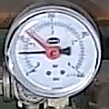
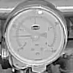

# Paine

Python application for reading a mechanical pressure gauge from camera images.
Captures a camera frame, measures the gauge's black needle, and optionally
publishes estimated pressure to MQTT with Home Assistant discovery.

> **Status: garage-specific prototype.** Validated only with my garage
> camera and pressure gauge. It automatically searches for the dial and normalizes
> its position/size, but assumes a near-front-on view, a black needle on a light
> dial, roughly unchanged camera roll, and a particular dial scale.
> It is **not a general-purpose gauge reader**. Other installations need
> their own scale/camera calibration and detection validation, plus adaptation or
> removal of the garage-specific final fallback. Readings are
> estimates, not safety-critical measurements.

See [Assumptions and scope](paine/ASSUMPTIONS.md) for the visual, geometry, scale,
sampling, camera, caching, and fallback limitations. Detecting position and size
does not automatically make this a generic rotary-gauge solution.

## Tested camera and example images

Tested with a **TP-Link Tapo C100**, using its authenticated RTSP stream over TCP
and the main **1920×1080** stream. Both daytime/color and infrared night-mode
images have been exercised on this garage's gauge. Other camera models and
gauges are not validated; matching the camera model alone does not make the
garage-specific scale calibration or final fixed fallback correct elsewhere.

| Daytime / lights on | Infrared night mode / lights off |
| --- | --- |
|  |  |

These are actual 120×120 gauge crops from the same setup, not synthetic examples.
They illustrate the loss of contrast in night mode; they do not establish
absolute pressure accuracy.

## Home Assistant Green / Home Assistant OS

This repository also contains a Home Assistant **app (formerly add-on)** for
64-bit ARM, including Green, and x86-64. No extra Raspberry Pi is needed.

### Install from GitHub

1. In Home Assistant, open **Settings → Apps → App store** (older versions:
   **Settings → Add-ons → Add-on store**).
2. Open **⋮ → Repositories** and add `https://github.com/raimohanska/paine`.
3. Refresh/check for updates, find **Paine pressure gauge**, and install it.
4. In its **Configuration** tab, enter the camera address (`hostname:port` for a
   custom/forwarded RTSP port) and camera/MQTT credentials. For the
   Mosquitto app, the broker hostname is normally `core-mosquitto` and port 1883.
   Use a broker account with permission to publish discovery and pressure.
5. If migrating an existing sensor, preserve its `sensor_id` and `device_id` to
   avoid duplicates. Set `suggested_area` if desired. Save, enable **Start on boot**,
   and start.
6. Check Logs for a published pressure reading. Find the device under **Devices**
   and assign it to an Area. Stop any previous external capture schedule.

The app immediately takes a batch of `shot_count` shots (default **3**) and
publishes their **median**, repeating every `capture_interval` seconds (default
**60**). Both are configurable in HA. It retries failed batches/publications
without publishing a partial reading. A strict majority must agree within a
0.15-bar range; unrelated readings cannot be published just because a median
can be calculated. Last-good gauge geometry remains in
scheduler memory: verify its small crop first and skip full-frame searches while
it stays valid. If verification fails, locate the gauge again. The original fixed
garage crop is a final fallback only when its rim verifies and it does not conflict
with the known gauge location. The latest batch photos/crops overwrite bounded
filenames in private `/data` storage. All dependencies are
installed in its own container, not in Home Assistant Core or the host OS.

App settings use Supervisor's private `options.json`, **not `.env`**. Credentials
are not baked into the image, but app backups include private configuration;
protect those backups. See [`paine/DOCS.md`](paine/DOCS.md) for all settings.

Logs include individual/median readings, crop verification/search decisions, and
an image-based day/color or night/IR estimate. Timestamps use Supervisor's local
timezone, including its name and UTC offset; the selected zone is logged at
startup. Day/night classification is a diagnostic inference, not camera telemetry.

To update: **App store → ⋮ → Check for updates**, then update the installed app.

### Local install alternative

Using Samba or the SSH app, put the contents of this repository's `paine/`
directory in the local app directory as a folder named `paine`. Current versions
use `/local_apps/paine`; older versions call it `/addons/paine`. In the app store,
select **Check for updates**, then install from **Local apps/add-ons**. Transfer
only that directory, not `.env`, photos, logs, or the development container.

### Development

The shared measurement and MQTT implementation lives in `paine/`. Root-level
Python files remain compatible CLI/import entry points; root requirements include
`paine/requirements.txt`. Build the app separately from the devcontainer:

```bash
docker build -t paine-app ./paine
```

The app uses a Debian-based Python image so ARM64 OpenCV/NumPy binary wheels can
be installed without a lengthy source build. The app Docker build context is
allowlisted to exclude credentials and diagnostic files.

Detailed native/cross-build, deployment, and update instructions are in
[`paine/BUILD.md`](paine/BUILD.md). The app has been used on Home Assistant Green;
tests and single-installation results are not a guarantee of correct readings on
a different camera/gauge.

## Development Container

With Docker running, open this repository in VS Code and select **Dev Containers:
Reopen in Container**. It includes Python, headless OpenCV, NumPy, Paho MQTT,
FFmpeg, pytest, and Ruff; dependencies synchronize from `requirements-dev.txt`.

```bash
python -m pytest -q
python -m ruff check .
```

The development image currently pins Python 3.10.11; the HA app uses Python 3.13.
This is not a requirement to compile an old Python on your deployment machine.
The development container is separate from the app image installed by HA.

## Camera Access

The current camera adapter uses Tapo's `/stream1` and `/stream2` RTSP paths with
camera-account authentication—not the Tapo cloud login. Use stream 1 for detail.
This is not yet a general configurable-URL camera adapter or a USB camera reader.

The app/CLI needs a network route to the camera's RTSP TCP port (usually **554**)
and the broker's MQTT TCP port (usually **1883**, or **8883** for TLS). RTSP uses
TCP, so no UDP video ports are required. Guest Wi-Fi/client isolation and VLAN
firewalls can prevent access even when both devices have internet connectivity.
Prefer private routing/VPN over exposing unencrypted RTSP to the internet.

## Capture and MQTT publishing

Install dependencies with `python -m pip install -r requirements.txt`, then run:

```bash
python capture_camera.py
```

Each CLI run captures three shots (override with `--shots 1` through `--shots 9`),
then prints/publishes their **median** pressure. The final image/crop are
`snapshot.jpg` and `snapshot_gauge.jpg`; earlier shots use `_shot1`, `_shot2`, etc.
Automatic/cached crops are normalized to 120×120; the legacy fixed fallback
keeps the reference crop scaled to the stream. The detector searches the
whole frame for the light-faced circular gauge, so position and modest size
changes no longer require a crop adjustment. Calibration
uses the 2- and 3-bar ticks; override with `--two-bar-angle` and `--three-bar-angle`
(clockwise degrees from 12 o'clock). Image-based pressure is an estimate.

Create your local, ignored `.env` with these settings (replace placeholders):

```dotenv
CAMERA_HOST=camera-host
CAMERA_USER=camera-user
CAMERA_PASSWORD=camera-password
MQTT_HOST=broker-host
MQTT_PORT=1883
MQTT_USER=mqtt-user
MQTT_PASSWORD=mqtt-password
MQTT_TLS=false
MQTT_SENSOR_NAME=Heating pressure
MQTT_SENSOR_ID=paine_pressure
MQTT_STATE_TOPIC=paine/pressure/state
MQTT_DISCOVERY_PREFIX=homeassistant
MQTT_EXPIRE_AFTER=300
MQTT_DEVICE_ID=paine_pressure_gauge
MQTT_DEVICE_NAME=Paine pressure gauge
```

Publishing is enabled when `MQTT_HOST` is set. Without it, capture still works.
Discovery also registers a device named **Paine pressure gauge**, which you can
assign to an Area in Home Assistant under **Settings → Devices & services →
Devices**. Optionally set `MQTT_SUGGESTED_AREA=Garage` to suggest its initial room.
Keep `MQTT_DEVICE_ID` stable; it is independent of the sensor's unique ID.
Other MQTT settings have the defaults shown; username/password are optional for
brokers allowing anonymous access. With `MQTT_TLS=true`, the default port is 8883
if `MQTT_PORT` is omitted; certificates and hostnames are verified using system
trust roots. Do not send credentials over untrusted networks without TLS.

Enable Home Assistant's MQTT integration against the same broker and discovery
prefix. The script publishes retained discovery configuration to
`homeassistant/sensor/paine_pressure/config`, then a **retained** reading to
the state topic. Both use QoS 1 and wait for broker acknowledgements before
disconnecting. Failures return a nonzero exit status; capture/measurement failures
do not publish a pressure reading. Discovery never includes broker credentials.

Keep the sensor ID stable to avoid duplicate entities. Schedule the command
externally, and set `MQTT_EXPIRE_AFTER` longer than the capture interval (e.g.
300 seconds for captures every 60 seconds). Home Assistant marks the sensor
unavailable when readings expire. Retained readings are replayed to new
subscribers, including after a Home Assistant restart; replaying an old reading
can restart the expiry timer, so keep captures scheduled regularly. If changing IDs/topics, remove the old retained
discovery configuration separately.

This setup is headless: save images to files and view them in the editor rather
than using `cv2.imshow()`. Do not install `opencv-python` alongside
`opencv-python-headless`; both provide the same `cv2` module.

## Raspberry Pi

Use **64-bit Raspberry Pi OS (aarch64)** and a maintained system Python; Python
3.11–3.13 is recommended for these dependencies. Python 3.5 / Raspbian Stretch and
32-bit Pi installations are not supported. No custom Python build is needed:

```bash
python3 --version
python3 -m venv .venv
. .venv/bin/activate
python -m pip install --upgrade pip
python -m pip install -r requirements.txt
python -c "import cv2, numpy; print(cv2.__version__, numpy.__version__)"
```

Then create `.env` and run/schedule the CLI as described above. If you already
have Home Assistant Green, the app avoids the need for a separate Pi.
