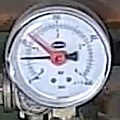
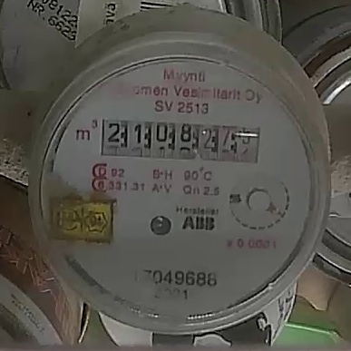

# Paine: mechanical pressure gauges and water meters in Home Assistant

Paine reads two kinds of mechanical instruments from camera images: a pressure
gauge with a needle and a water meter with numbered wheels. It processes images
locally and publishes readings to Home Assistant through MQTT discovery.

| | Pressure gauge | Water meter |
| --- | --- | --- |
| Tested face |  |  |
| What it reads | The angle of a dark needle on a light, clockwise 0–4 bar dial. | The numbered wheels of the pictured meter, in 10-litre steps. |
| What HA shows | Estimated pressure in bar. | **Water meter total** and **Daily water consumption**, both in m³. |
| Lighting | The needle is readable in daylight and in the camera’s infrared night mode. | Use steady visible light. On this meter the red digits are practically unreadable in infrared night mode; a small night light works. |

Both readers were tested in one installation using a TP-Link Tapo C100’s 1080p
main stream. The pressure reader needs a nearly front-on view and calibrated
tick angles. The water reader is calibrated for this meter face and mirror
placement. A similar-looking dial or camera alone does not guarantee a match.

## Set up in Home Assistant

1. In **Settings → Apps → App store → ⋮ → Repositories**, add
   `https://github.com/raimohanska/paine`. Install **Paine pressure gauge**
   (the store name covers both readers). Home Assistant Green and x86-64 are supported.
2. Enable the MQTT integration. In the app’s **Configuration** tab, enter the
   same broker and its credentials (normally `core-mosquitto:1883` for Mosquitto).
   Use the camera’s local RTSP account, not the Tapo cloud login, for each camera:
   - **Pressure:** Set **Camera 1**’s address, account and sensor ID. Enter the angles
     of the 2- and 3-bar marks, clockwise from 12 o’clock. **Camera 2** is for a second pressure gauge.
   - **Water:** Set **Water meter — address** and its account. Set a plausible
     maximum flow for your supply (default 40 L/min). Leave the address blank to disable it.
3. Save, start the app and enable **Start on boot**. Check **Logs**, then look
   under **Settings → Devices & services → MQTT** for the sensors.

## Check the first readings

- **Pressure:** Compare the reported bar value with the needle. By default the
  app takes three shots each minute and publishes the median only if a majority agree.
- **Water:** Compare the first confirmed total with the wheels. Establishing it
  takes three agreeing nine-frame bursts. An uncertain reading leaves the last
  confirmed total visible; check `[water]` in the logs for its age. Daily use is
  measured from the first confirmed reading of the local day, and that starting
  value survives restarts.

The app’s **Documentation** tab (`paine/DOCS.md`) covers calibration, water
diagnostics and troubleshooting. For existing pressure profiles and upgrades,
see `paine/CONFIGURATION.md`.

## Development

The app and shared readers live in `paine/`. Use the VS Code dev container, or
install `requirements-dev.txt`, then run:

```bash
python -m pytest -q
python -m ruff check .
docker build -t paine-app ./paine
```

For local capture tools, see `python capture_camera.py --help` (pressure) and
`python capture_water_meter.py --help` (water). Build and local installation
instructions are in `paine/BUILD.md`.
